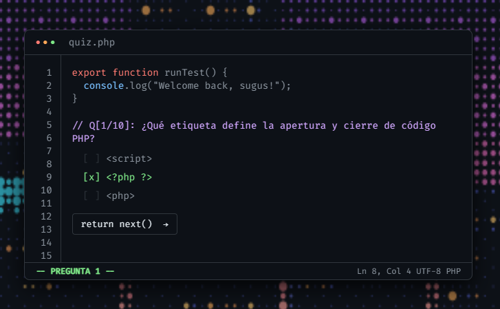
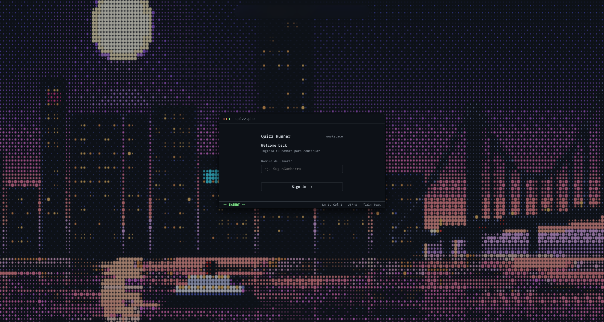
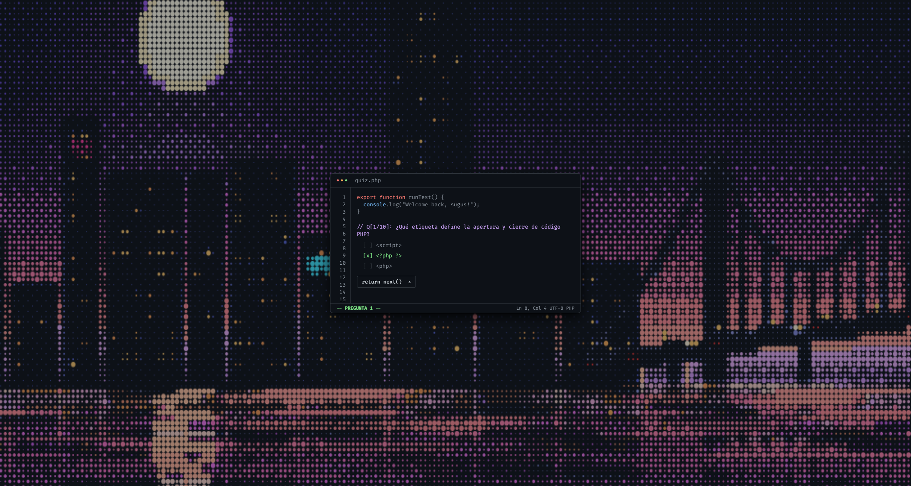
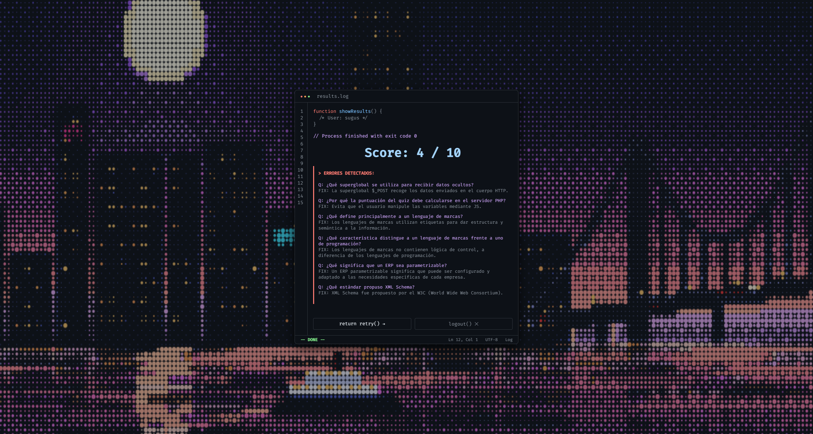

<!--nota para mi profesora:
queria comentarte que he querido hacer el readme bien estructurado para presentar el proyecto como es debido
sin embargo veras q los comentarios del codigo (incluido este) tson informales y coloquiales
lo he hecho asi para que veas el proceso detras con mi toque cmo persona, q veas las horas d busqueda estetica, investigar como funcionan las cosas, ensayo y error, referencias d lo q nos enseñas en clases, mi propia cosecha como persona autodidacta... espero q t guste el restultado! un abrazote!-->

 

Motor de quizz desarrollado para un reto de la asignatura **Desarrollo Web en Entorno servidor** de DAW.

Es una aplicación web dinámica construida en PHP que procesa formularios, evalúa respuestas, mantiene el estado del usuario y consume una *API REST* externa con una estética de terminal de código inmersiva.

  

---

## Cómo funciona

La app consta de 4 vistas principales que interactúan entre sí usando la arquitectura cliente-servidor:

1. **Login `[index.php](index.php)`**: Lo primero que se ve. Recoge el nombre de usuario mediante un formulario sencillo POST y genera una cookie válida por 24 horas para recordar al usuario.

  

2. **Cuestionario `[quiz.php](quiz.php)`**: Al cargar el sistema saluda al usuario (`"Welcome back, [Nombre]!"`). El servidor consulta la bbdd de supabase (creada para un proyecto del año pasado) mezclando preguntas aleatorias y fijas. Construye dinámicamente un formulario estructurado. JS se encarga solamente de mostrar una pregunta a la vez por mejora de la UX, pero no conoce las respuestas.

  

3. **Procesamiento `[procesar.php](procesar.php)`**: Recibe las respuestas enviadas por el usuario, las compara con las soluciones reales y calcula la nota. Guarda las puntuaciones y errores en `$_SESSION`.
4. **Resultados `[resultado.php](resultado.php)`**: Imprime la puntuación final extraída de la sesión y detalla los errores cometidos junto con su explicación para que el usuario pueda aprender de ellos (feedbakc)

  

---

## Estética

Todo el proyecto se ha diseñado simulando un editor de código y una terminal de comandos (*Syntax Highlight Pass*).

Se ha separado toda la capa de presentación en un archivo de `[estilos](estilos.css)` tomando inspiración de [ascii-magic](ascii-magic.com).

* **Fondo**: He usado la pieza *[harbour-neon-skyline](https://www.ascii-magic.com/ascii/harbour-neon-skyline)* adaptándolo para que ocupase toda la pantalla.
* **Ventanas**: Todas las ventanas que recogen cada parte del proyecto se inspiran en *[Syntax Highlight Pass](https://www.ascii-magic.com/ascii/syntax-highlight-pass)*.
* **Login**: La estética del login se inspira en *[Login Form](https://www.ascii-magic.com/ascii/login-form)*.

---

## REquisitos del reto

### Seguridad: servidor vs cliente

El cálculo de la puntuación siempre debe hacerse en el lado servidor porque en el lado del cliente (navegador) corre riesgo de ser manipulable.

Si validáramos las respuestas en el frontend usando JS cualquiera podría abrir la consola inspeccionando un elemento (o con F12), modificar las variables y falsear la puntuación.

Al hacerlo en PHP el servidor protege la lógica sensible, evalúa por dentro todo y solo devuelve al usuario el HTML final generado.

### Manejo de forms y lógica

La recolección de datos se hace de forma segura con la superglobal `$_POST`.. En `procesar.php` la función `evaluarCuestionario()` recorre un array con las respuestas del usuario y lo compara con el array de soluciones almacenado previamente.

### Persistencia y gestión de estado

Para que el usuario no pierda su pregreso el sistma usa:

* **Cookies `setcookie()`**: se usa en el login para recordar el nombre de usuario y personalizar la experiencia con la bienvenida.
* **Sesiones**: Todos los scripts lógicos comienzan con `session_start()`. La nota parcial, el total de preguntas y fallos se almacenan en `$_SESSION` para sobrevivir a las redirecciones HTTP.

### Integración de datos

He querido dar un paso más allá integrando el proyecto con una bbdd de terceros (*Supabase*) que hice el año pasado para ayudar a mis compañeros a estudiar con baterías de preguntas para los exámenes.

Las creds se leen de forma segura desde el `.env` (usando `parse_ini_file`) y las preguntas se extraen mediante peticiones HTTP configurando cabeceras de autorización a través de **`cURL`** en PHP.

---

` Creado con mucho café y solecito de Cádiz · @SugusGamberra `